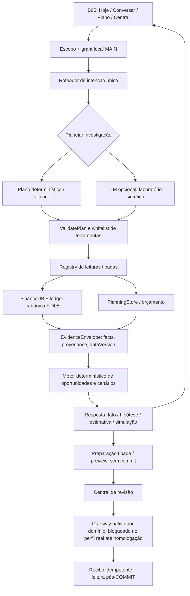

# I3-00 V2 — Arquitetura funcional orientada a resultados

**Status:** contrato arquitetural proposto, não runtime implementado. **Baseline verificada por leitura:** PR #76 / 1bc1b89bf5bdefc0196b0851e690a99f825ca85a. **Staging paralelo:** PR #88 / 200aafb6f8000e7d6c1dad221a63482356ee4510; QA não homologado. **UI referência:** B05 Hoje V6 / Conversar e Plano V5 na issue #84. Nenhum cálculo novo deve divergir de shared/finance-period-ledger.mjs.

## 1. Diagrama de fluxo proposto



**Interpretar e explicar nunca equivalem a determinar valor contábil.** Modelo de linguagem não recebe token, owner, extrato pessoal bruto, SQL livre nem capacidade de escrever. O MAIN/serviço controla leitura, calcula e revalida; renderer não emite permissão.

## 2. Seis subsistemas — decisão e limites

| Subsistema | Reutilização comprovável | Nova responsabilidade | Não fazer |
|---|---|---|---|
| A — Intenção | src/intelligence-local.ts, electron/intelligence-orchestrator.cjs (regex IC-v1/IC2/V3) | normalizar objetivo, período, entidades e follow-up; devolver intents + confiança + lacunas | roteamento visual concorrente alterar resultado sem aviso |
| B — Orquestração | intelligence-provider.cjs validatePlan (máx. quatro etapas), intelligence-tools.cjs | grafo de etapas somente leitura, limites globais, cancelamento/stale/fallback e verificação após cada chamada | SQL dinâmico, loop infinito, alteração por texto |
| C — Verdade financeira | FinanceDB; financial-intelligence.cjs; shared/finance-period-ledger.mjs; D05; PlanningStore | read adapters por intervalo com cobertura, dataVersion, filtros e fonte | somar bank + manual sem conciliar; considerar renda prevista como POSTED |
| D — Recomendações | FinancialReadTools, I2-D/E para categoria, operational cards | motor de oportunidades financeiras (economia, recorrência, tendência, viabilidade) e rank explicável | sugerir cortes essenciais como certos ou duplicar redução |
| E — Continuidade | ConversationContextStore TTL 10 min; threads locais; AIPersonalStore de demonstração | contexto por escopo, metas opt-in futuras, invalidar memórias ao atualizar dado | confundir histórico visual com meta persistida ou reutilizar grants revogados |
| F — Execução supervisionada | D05PersonalWriteGateway com sandbox, backup, nonce e receipts | drafts de orçamento/planejamento, gateways específicos após QA | copiar approvedForPersonal true; escrever no ledger por IPC genérico |

## 3. Envelope único de evidência (proposta v1)
```json
{
  "version": 1,
  "queryId": "q-synthetic-001",
  "status": "ready",
  "readOnly": true,
  "scope": {"source": "bank", "profile": "real", "accountRef": "acc-fixture", "start": "2026-10-01", "end": "2026-11-30"},
  "dataVersion": "fixture-v1",
  "asOf": "2026-11-30T23:59:59Z",
  "coverage": {"state": "complete", "readRows": 14, "hasMore": false, "missingPeriods": []},
  "exclusions": ["PENDING", "TRANSFER", "IGNORED"],
  "facts": [{"factId": "fact-expenses", "metric": "expensesCents", "valueCents": 42000, "period": "2026-11", "method": "canonical_ledger", "sourceIds": ["n01", "n02", "n03", "n04"]}],
  "hypotheses": [],
  "estimates": [],
  "simulations": [],
  "insightIds": []
}
```
Este é um exemplo de **saída-alvo em fixture bancária sintética isolada com rótulo real**, não prova de endpoint pronto nem autorização para banco pessoal. A mesma evidência canonicalizada serve Hoje, Conversar, Plano e Central. status permitido: ready / partial / no_data / denied / stale / unsupported / error. Gráficos não devem ignorar partial.

## 4. Contrato de escopo e dataVersion
- Scope contém owner **interno ao MAIN**, profile, source, accountIds permitidos, período e planningConsent separado. owner e token não são argumentos fabricáveis pelo modelo; os campos expostos ao planejador são IDs de escopo opacos.
- No início, antes/depois de cada tool, e imediatamente antes de responder: revalidar grant vivo + account + versão do ledger + escopo. Se mudou, abandonar resposta quantitativa e exigir recálculo.
- cache chaveado por ownerHash, source, perfil, conjunto de contas, intervalo, filtros, contractVersion e dataVersion; cache de dados financeiros apenas local, sem vazamento entre perfis. Alteração de sync invalida cache e insights derivados.
- Para cobertura partial ou truncation: declarar quantidade lida, indicação de total quando disponível, intervalo faltante e proibir afirmações globais de economia “garantida”.
- Um fato tem factId estável enquanto dataVersion e cálculo permanecem iguais; ao mudar dados, nova versão e revalidação de todos os insights filhos.

## 5. Roteamento e planner híbrido
- Primeira etapa: classificador de intenção local para oito intenções IC-v1 e nove tools IC2; perguntas cobertas podem ser resolvidas sem LLM.
- Pedido complexo: decompor em etapas tipadas com dependências. O planejador é sujeito a whitelist, parâmetros estritos, duração máxima, cota de chamadas, limite de período e cardinalidade; plano inválido cai em fallback local ou responde unsupported específico.
- POC LLM planejada desde M0 e **não executada**: contexto exclusivamente sintético/sem extratos reais, comparação por intenção, latência/custo/precisão, sem endpoint de produção. O planner não fornece valores financeiros finais.
- Evitar ampliar diretamente regex V3/IC2; criar seam de roteamento que preserva compatibilidade enquanto migra famílias com golden tests.

## 6. Motor de oportunidades e explicabilidade
```text
scan(scope, dataVersion) -> candidate[]
candidate = {
 insightId, evidenceFingerprint, type, title, importance,
 evidenceIds, uncertainty, impactCentsMin, impactCentsMax,
 overlapGroup, assumptions, nextAction, generatedAt, expiresAt
}
```
- Tipos iniciais: category_delta, merchant_growth, recurring_candidate, budget_risk, discretionary_savings, upcoming_commitment, category_review.
- Impacto usa métodos puros sobre fatos reconciliados. Não soma duas propostas que cortam o mesmo conjunto de lançamentos; registrar overlapGroup e selecionar uma alternativa.
- Candidata recorrente exige observações em ciclos diferentes; nome parecido é hipótese, não assinatura confirmada. Cancelamento externo não é ação disponível.
- Ranking: segurança e relevância do prazo primeiro, depois impacto e certeza; motivo do score sempre exposto.
- Ciclo: detected → proposed → seen → dismissed/snoozed/accepted → stale/expired; persistência de escolhas somente com escopo autorizado, não repetir mesma mensagem todo dia.

## 7. Superfícies B05: contrato de continuidade
- Hoje recebe até três insights com IDs e cobertura; sem grant, CTA de consentimento e dados vazios.
- Conversar recebe pergunta + insightId opcional + evidenceEnvelope; segue no mesmo dataVersion, reconsulta quando stale.
- Plano recebe planId, lista de ações com evidenceIds, estimativas, medidas de progresso. Plano não é automaticamente orçamento gravado.
- Central recebe proposalId, before/after, autorização necessária e estado; rejeição não altera o ledger.
- Chat lateral compartilha threadId/contexto **apenas dentro do mesmo escopo** e nunca transporta token secreto.
- Motion/design seguem handoff B05; arquitetura não altera layout ou animações aprovadas.

## 8. Falhas críticas e testes
| Falha | Resposta obrigatória | Evidência de QA |
|---|---|---|
| PENDING/transfer somados | falhar reconciliação, não emitir resposta | fixture F1 e expected-cents |
| Mudança de conta no meio do plano | stale, nenhum resultado de outra conta | troca de grant entre etapas |
| Orçamento zero confundido com ausência | zero preservado, sem divisão por zero | T-006/T-049 |
| 2.600 registros, adaptador lê 2.500 | partial, não alegar completude | F6 |
| LLM sugere SQL ou write | rejeitar plano, fallback local | prompt injection sintético |
| Mesmo insight em 3 telas com números diferentes | gate FAIL: evidência única obrigatória | golden snapshots por insightId |
| Falha após COMMIT sintético | recibo/recovery, sem repetir write | T-050 |
| Fonte demonstrativa tratada como pessoal | bloquear e rotular synthetic | T-048 |

## 9. Trade-offs
Preferir orquestração simples/pequena a “agente irrestrito”; consultas paginadas seguras a carregar histórico inteiro; cálculo local replicável a números gerados por LLM; proatividade baseada em eventos versionados a notificações diárias sem utilidade. Depender de integração UI apenas como contrato, não bloquear M0/M1 por B05.

**Fronteira deste PR:** apenas documentação, nenhuma alteração em Electron, preload, database, secrets, API, CircleCI ou main.


## Adendo V2.1 — encaixe real do B05 no PR #94

O fluxo da V2.1 deverá partir de PR #94 HEAD `d6693b42b21a1e4bf957f882dc3321506eaaa3c8`. Conversar V5 (`src/intelligence-b05-chat.ts`) renderiza `renderIntelligenceMessageItem` e o composer `renderIntelligenceComposer`; o envio com grant de leitura vai para `localFinancialSubmit` em `src/intelligence-local.ts`, que usa `intelligenceIC2ReadQuery` (preload já existente). O gateway `electron/intelligence-ic2-adapter.cjs` limita a resposta a quatro fatos/três blocos e revalida grant. A investigação pode ser uma extensão do orquestrador IC2, sem inventar chat ou novo IPC. A ligação do Pulso Financeiro V6 ao snapshot composto ainda tem dependência própria: **não** habilitar nem declarar implementada em M1-S1. Não alterar #94 nesta branch documental.
